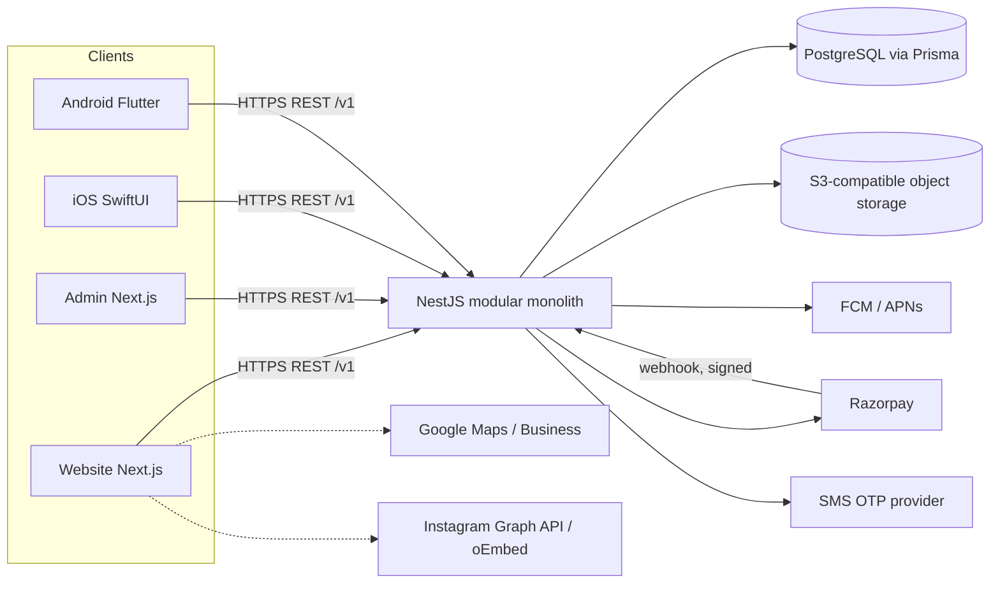

# Architecture (v0.1 DRAFT)

## System diagram

## Decisions
- **Modular monolith** (NestJS): one deployable, modules with explicit boundaries; extract only on real need.
- **Multi-branch ready**: `branch_id` on tenant-scoped tables; a request-scoped branch context; single branch seeded initially.
- **Auth**: short-lived JWT access (15 min) + rotating refresh tokens (hashed in DB, reuse detection). OTP for members; email+password (argon2) for staff.
- **RBAC**: roles → permissions tables; `@RequirePermission()` guard; trainer/member scoping enforced in service queries, not controllers.
- **Payments**: backend creates Razorpay order; client pays; backend verifies HMAC signature and consumes webhook; `payment_transactions` unique on gateway payment id for idempotency; activation in a single Prisma `$transaction`.
- **API contracts**: OpenAPI generated from NestJS; `packages/api-contracts` holds the spec, `packages/shared-types` holds TS types for web apps. Swift/Dart clients generated from the spec.
- **Storage**: private bucket, pre-signed upload/download URLs, MIME/size validation.
- **Environments**: dev / staging / prod via Docker Compose + env files; secrets never in clients.
- **Observability**: structured logging (pino), request IDs, error tracking (Sentry), health endpoint.
- **Time**: store UTC, display Asia/Kolkata; membership dates are calendar dates.

## Backend module layout (`backend/api/src/modules`)
auth, users, roles-permissions, branches, members, trainers, membership-plans, subscriptions, payments, attendance, enquiries, trial-bookings, exercises, workouts, diets, progress, notifications, announcements, reports, uploads, audit, settings, public (website content), health.

## Deployment
Docker images per app; Postgres managed or containerised with daily `pg_dump` to object storage; reverse proxy (Caddy/Nginx) with TLS; CI via GitHub Actions (lint, test, build, migrate).
