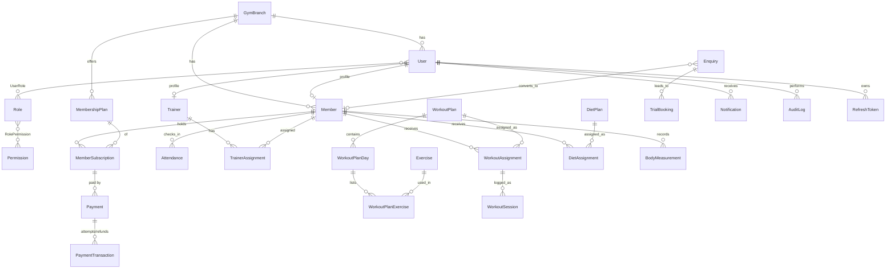

# Database (PostgreSQL + Prisma) — v0.1 DRAFT

Conventions: UUID PKs, `created_at`/`updated_at` on all tables, `deleted_at` soft-delete on members, users, plans, trainers, exercises, templates (NOT on payments/transactions/attendance/audit — those are append-only). Money in integer paise. `branch_id` on tenant data.

## ER diagram

## Key tables (columns abbreviated)
- **users**: id, branch_id?, email? (unique), phone? (unique), password_hash?, status, last_login_at.
- **roles / permissions / user_roles / role_permissions**: seeded OWNER, ADMIN, TRAINER, MEMBER.
- **refresh_tokens**: user_id, token_hash, family_id, expires_at, revoked_at. **otp_codes**: target, code_hash, expires_at, attempts, consumed_at.
- **members**: user_id, branch_id, member_code (unique per branch), name, dob, gender, address, emergency_contact_*, photo_key, status (ACTIVE/INACTIVE/EXPIRED/BLOCKED), joined_on, qr_secret.
- **membership_plans**: branch_id, name, duration_days, price_paise, tax_percent, features jsonb, is_active.
- **member_subscriptions**: member_id, plan_id, start_date, end_date, status (PENDING/ACTIVE/FROZEN/EXPIRED/CANCELLED), frozen_from/to, price_paise_snapshot, parent_subscription_id (renewal chain). Constraint: no overlapping ACTIVE per member (exclusion constraint on daterange).
- **payments**: subscription_id, member_id, amount_due, amount_paid, status (PENDING/PARTIAL/PAID/REFUNDED), receipt_no (unique), idempotency_key (unique).
- **payment_transactions**: payment_id, method (CASH/UPI/CARD/ONLINE), type (CHARGE/REFUND), amount_paise, gateway ('razorpay'), gateway_order_id, gateway_payment_id (unique), signature_verified, status, raw_event jsonb (no card data).
- **attendance**: member_id, branch_id, check_in_at, check_out_at, method (QR/MANUAL), recorded_by. Unique (member_id, local_date) enforces no duplicate check-in; index (branch_id, check_in_at).
- **enquiries**: name, phone, source (WEBSITE/WHATSAPP/WALKIN), status, follow_up_at, assigned_to, converted_member_id. **trial_bookings**: enquiry_id, scheduled_at, status.
- **trainers**: user_id, qualifications, specializations[], experience_years, bio, availability jsonb. **trainer_assignments**: trainer_id, member_id, from/to.
- **exercises**, **workout_plans**, **workout_plan_days**, **workout_plan_exercises** (sets, reps, rest), **workout_assignments**, **workout_sessions** (completed_at, notes).
- **diet_plans**, **diet_assignments**. **body_measurements** (member_id, measured_on, weight_kg, chest/waist/hips/arms/thighs cm, photo_keys[]).
- **notifications**, **announcements**, **device_tokens**, **audit_logs** (actor_id, action, entity, entity_id, before/after jsonb, ip, at), **gallery_items**, **site_settings**.

## Indexes of note
members(branch_id,status), members(phone), subscriptions(member_id,status), subscriptions(end_date) for renewal jobs, attendance(branch_id,check_in_at), enquiries(status,follow_up_at), audit_logs(entity,entity_id).

## Transactions
Payment verification, subscription activation/renewal/extension, and refund each run in one DB transaction with row locks on the subscription/payment.
